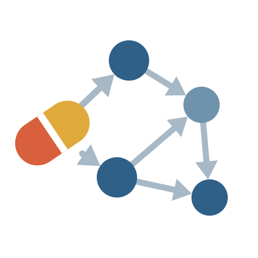
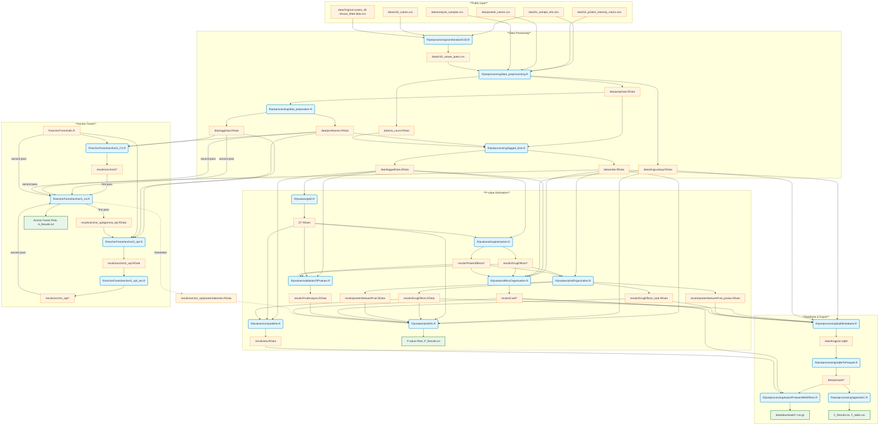

# Drug-Prot: A query system for statistical inference of drug effects and interactions in dynamic proteomic networks <a href="https://markus-ulmer.ch/drugprot/"></a>

This repository contains all the code used for the paper "[*Drug-Prot: A query system for statistical inference of drug effects and interactions in dynamic proteomic networks*](https://doi.org/10.64898/2026.06.17.732914)" by Markus Ulmer, Rui Sun, Liujia Qian, Ruedi Aebersold, Tiannan Guo, and Peter Bühlmann (2026).


*The image is drawn from the estimated dependencies and drug effects by [`coverImage.py`](Python/coverImage.py), see [below](#where-the-numbers-and-figures-of-the-paper-come-from).*

All the statistical analysis was run on [*Euler*](https://scicomp.ethz.ch/wiki/Euler) using the batch jobs in the [`slurm`](slurm) folder. See [*here*](https://scicomp.ethz.ch/wiki/Euler_applications_and_libraries_ubuntu) and [`sessionInfo.txt`](sessionInfo.txt) for details about the libraries used. The figures, the Parquet store, the CSV export and the numbers of S1 Appendix, Section C were produced on a local machine, see [`sessionInfo_local.txt`](sessionInfo_local.txt).

## Input data

The analysis runs from publicly available data. Three sources are needed.

**Perturbation proteomics**, from [db.prottalks.com](https://db.prottalks.com), published with [*Sun, R., Qian, L., Li, Y., et al. (2026). An operational perturbation proteomics-based virtual cell model. Nature.*](https://doi.org/10.1038/s41586-026-11001-9)

```
01_sample_info.xlsx
02_protein_intensity_matrix.xlsx
```

**Analysis inputs**, from the [Drug-Prot data deposit](https://doi.org/10.5281/zenodo.21508012), recording the sample selection, the protein identifiers, and the IC50 values used here

```
analysis_samples.csv
protein_names.csv
ic50_values.csv
```

**Combination IC50 values**, from the anchored screen of [*Jaaks, P., Coker, E. A., Vis, D. J., et al. (2022). Effective drug combinations in breast, colon and pancreatic cancer cells. Nature.*](https://doi.org/10.1038/s41586-022-04437-2), available on [Figshare](https://doi.org/10.6084/m9.figshare.16843597)

```
Original screen_All tissues_fitted data.csv
```

Place all six files in `data/`. The expected layout is

```
📂 DrugProt-Paper
├── 📂 R
│   ├── 📂 preprocessing
│   ├── 📂 pvalues
│   ├── 📂 anchorForest
│   └── 📂 postprocessing
├── 📂 Z
├── 📂 data
│   ├── 📊 01_sample_info.xlsx
│   ├── 📊 02_protein_intensity_matrix.xlsx
│   ├── 📊 analysis_samples.csv
│   ├── 📊 protein_names.csv
│   ├── 📊 ic50_values.csv
│   └── 📊 Original screen_All tissues_fitted data.csv
├── 📂 figures
├── 📂 outfiles
├── 📂 slurm
└── 📂 results
    ├── 📂 Coef
    │   ├── 📂 drugs
    │   ├── 📂 drugs_total
    │   └── 📂 proteins
    ├── 📂 DrugEffects
    ├── 📂 ProteinEffects
    ├── 📂 anchorG
    └── 📂 anchor_opt
```

Create the empty directories before submitting any job, since the scripts write into them without creating them.

```bash
mkdir -p Z figures outfiles results/{DrugEffects,ProteinEffects,anchorG,anchor_opt} results/Coef/{drugs,drugs_total,proteins}
```

## Reproducing the results

### 1. Analysis Pipeline
Run the following jobs in order to reproduce the model fits:

1.  [`prepare.slurm`](slurm/prepare.slurm): **Preprocessing** of the data. It runs [`combinationIC50.R`](R/preprocessing/combinationIC50.R), [`data_preprocessing.R`](R/preprocessing/data_preprocessing.R), [`data_preparation.R`](R/preprocessing/data_preparation.R), and [`lagged_time.R`](R/preprocessing/lagged_time.R), in this order.
2.  [`getZ.sh`](slurm/getZ.sh): Calculates the projections for the **de-sparsified Lasso regressions** with [`getZ.R`](R/pvalues/getZ.R), one job per time point, for the direct-effect models (`Z/{6,24,48}.RData`) and the total-effect models (`Z/{24,48}_mode2.RData`).
3.  [`fit.slurm`](slurm/fit.slurm): Fits the models with [`drugInteraction.R`](R/pvalues/drugInteraction.R). At 24 and 48 hours each protein is fitted twice, conditional on the lagged proteome (direct drug effects and protein dependencies) and on the drugs alone (total drug effects, files ending in `_mode2`).
4.  [`pValAnalysis.slurm`](slurm/pValAnalysis.slurm): Simulation study validating the **type I error and power** of the p-values with [`validationOfPvalues.R`](R/pvalues/validationOfPvalues.R). It reuses the coefficients and noise levels of the fit, so it runs after `fit.slurm`.

The **Anchor Forest** analysis depends only on the preprocessing and can run alongside steps 2 to 4:

1.  [`anchorG_CV.sh`](slurm/anchorG_CV.sh): Out-of-environment cross-validation over $\gamma$ with [`anchorG_CV.R`](R/anchorForest/anchorG_CV.R), one job per value of $\gamma$. Each job leaves out every one of the eight environments in turn and stores the squared out-of-environment residuals.
2.  [`anchorG_vis.R`](R/anchorForest/anchorG_vis.R), first pass: Determines the most difficult environment and the optimal $\gamma$, saves both to `results/anchor_opt/gamma_opt.RData`, and stops.
3.  [`anchorG_opt.slurm`](slurm/anchorG_opt.slurm): Refits the Anchor Forest on all data with the optimal $\gamma$, using [`anchorG_opt.R`](R/anchorForest/anchorG_opt.R).
4.  [`anchorG_opt_res.slurm`](slurm/anchorG_opt_res.slurm): Calculates regularization paths, stability selection, and partial dependencies with [`anchorG_opt_res.R`](R/anchorForest/anchorG_opt_res.R).
5.  [`anchorG_vis.R`](R/anchorForest/anchorG_vis.R), second pass: **Visualizes** the results, saves findings to `results/A_Results.txt`, and writes the protein selection to `results/anchor_opt/proteinSelection.RData`.

> *Note: `anchorG_vis.R` decides which pass to run by checking for `results/anchor_opt/var_importance.RData`. Start from an empty `results/anchor_opt/` so that a file from an earlier run does not skip the first pass.*

> *Note: The grid `gamma_seq` in `anchorG_CV.R` is on the square-root scale. The scripts square it, so the grid value 3.8 is $\gamma = 14.44$ in the paper. `anchorG_vis.R` keeps only $\gamma \geq 1$, and the trees are not pruned.*

All random steps are seeded. The imputation of missing values is deterministic, and each protein in `fit.slurm` uses its own seed, so the results do not depend on scheduling or the number of cores.

### 2. Figures & Reported Numbers
Once both parts of the pipeline are complete, run these R scripts in order:

1.  [`pValOrganization.R`](R/pvalues/pValOrganization.R): **Organizes** the p-values, for direct and total drug effects.
2.  [`effecsOrganization.R`](R/pvalues/effecsOrganization.R): Collects the estimated coefficients per drug (direct and total effects) and per protein into `results/Coef/`.
3.  [`pValVis.R`](R/pvalues/pValVis.R): **Visualizes** the p-values for the protein selection of the Anchor Forest and the validation study, and saves findings to `results/P_Results.txt`.

### 3. Database & Export
These scripts turn the model output in `results/` into the artifacts published in the [Drug-Prot data deposit](https://doi.org/10.5281/zenodo.21508012): the Parquet store that backs the [Shiny application](https://github.com/markusul/DrugProt), and the human-readable CSV export. Run them after step 2.

1.  [`computeEta.R`](R/pvalues/computeEta.R): Computes the bias factor $\eta_j$ of every predictor (Zhang and Zhang, 2014), which the export reports next to each p-value.
2.  [`buildDatabase.R`](R/postprocessing/buildDatabase.R): Collects all p-values and coefficients into a single indexed SQLite database. Drug p-values and coefficients carry an `effect_type` column (`direct` or `total`).
3.  [`sqliteToParquet.R`](R/postprocessing/sqliteToParquet.R): Converts that database into one compressed Parquet file per table.
4.  [`exportPvaluesWithEffects.R`](R/postprocessing/exportPvaluesWithEffects.R): Writes the human-readable CSV export, with effect magnitudes and $\eta$ attached per row.
5.  [`appendixC.R`](R/postprocessing/appendixC.R): Queries the Parquet store with the corrections of the application and writes the numbers of the case study in S1 Appendix, Section C to `results/C_Results.txt` and `results/C_table.csv`.

> *Note: `sqliteToParquet.R` exports every table it finds, including SQLite's internal `sqlite_stat1` and `sqlite_stat4` tables created by the closing `ANALYZE`. Remove these before publishing the Parquet directory.*

> *Note: `buildDatabase.R` stores only the **sign** of the protein-network coefficients, which is all the application needs to colour edges. `exportPvaluesWithEffects.R` therefore reads the magnitudes directly from `results/Coef/`, and must run where `results/` is still available.*

To deploy the application locally, copy `data/parquet/` into the root of the [DrugProt](https://github.com/markusul/DrugProt) repository as `parquet/`.

## Where the numbers and figures of the paper come from

The numbers reported in the paper are written to three text files.

| File | Written by | Used in |
| :--- | :--- | :--- |
| `results/P_Results.txt` | [`pValVis.R`](R/pvalues/pValVis.R) | Results, statistical evidence in the full dataset and the use case |
| `results/A_Results.txt` | [`anchorG_vis.R`](R/anchorForest/anchorG_vis.R) | Section 4.1, Anchor Forest |
| `results/C_Results.txt`<br>`results/C_table.csv` | [`appendixC.R`](R/postprocessing/appendixC.R) | S1 Appendix, Section C |

| Figure | File | Written by |
| :--- | :--- | :--- |
| 1 | `figures/Fig1.png`<br>`figures/Fig1.tif` | [`schematicFigures.R`](R/postprocessing/schematicFigures.R) |
| 2 | `figures/Fig2.png`<br>`figures/Fig2.tif` | [`pValVis.R`](R/pvalues/pValVis.R) |
| 3 | `figures/Fig3.png`<br>`figures/Fig3.tif` | [`pValVis.R`](R/pvalues/pValVis.R) |
| 4 | `figures/Fig4.png`<br>`figures/Fig4.tif` | [`pValVis.R`](R/pvalues/pValVis.R) |
| 5 | `figures/Fig5.png`<br>`figures/Fig5.tif` | [`schematicFigures.R`](R/postprocessing/schematicFigures.R) |
| 6 | `figures/Fig6.png`<br>`figures/Fig6.tif` | [`anchorG_vis.R`](R/anchorForest/anchorG_vis.R) |
| 7 | `figures/Fig7.png`<br>`figures/Fig7.tif` | [`anchorG_vis.R`](R/anchorForest/anchorG_vis.R) |
| 8 | `figures/Fig8.png`<br>`figures/Fig8.tif` | [`anchorG_vis.R`](R/anchorForest/anchorG_vis.R) |

Each figure is written twice by `save_fig()` in [`figureUtils.R`](R/figureUtils.R), as PNG for the manuscript and as TIFF in the format that PLOS requires.

Figures 1 and 5 are schematic drawings. Figure 1 is drawn by the script and shows three screenshots of the application from `schematics/`. Figure 5 is the causal graph.

Three more images are not figures of the paper. They are made for the striking image of the journal and for presentations.

| Image | File | Written by |
| :--- | :--- | :--- |
| Striking image 1 | `figures/StrikingImage1.png`<br>`figures/StrikingImage1.tif` | [`schematicFigures.R`](R/postprocessing/schematicFigures.R) |
| Striking image 2 | `figures/StrikingImage2.png`<br>`figures/StrikingImage2.tif` | [`schematicFigures.R`](R/postprocessing/schematicFigures.R) |
| Cover image | `figures/CoverImage.png`<br>`figures/CoverImage.tif` | [`coverImage.py`](Python/coverImage.py) |

The cover image shows the significant dependencies among the 300 proteins with the most dependencies and the drug effects on one selected protein. The script reads the Parquet store, so it runs after `sqliteToParquet.R`. It needs Python 3 with `numpy`, `matplotlib`, `opencv-python-headless`, `pillow` and `duckdb`.

```bash
python3 Python/coverImage.py data/parquet figures/CoverImage --protein SPRR3
```

## More details on the different scripts

<details>
<summary><strong>📂 Click to view detailed File Inputs & Outputs</strong></summary>

### 1. Data Processing

| Script | Needs (Input) | Generates (Output) |
| :--- | :--- | :--- |
| [`R/preprocessing/combinationIC50.R`](R/preprocessing/combinationIC50.R) | `data/Original screen_All tissues_fitted data.csv`<br>`data/ic50_values.csv`<br>`data/01_sample_info.xlsx` | `data/ic50_values_jaaks.csv` |
| [`R/preprocessing/data_preprocessing.R`](R/preprocessing/data_preprocessing.R) | `data/01_sample_info.xlsx`<br>`data/02_protein_intensity_matrix.xlsx`<br>`data/protein_names.csv`<br>`data/analysis_samples.csv`<br>`data/ic50_values_jaaks.csv` | `data/drugLookup.RData`<br>`data/na_count.RData`<br>`data/prepData.RData` |
| [`R/preprocessing/data_preparation.R`](R/preprocessing/data_preparation.R) | `data/prepData.RData` | `data/aggData.RData`<br>`data/protNames.RData` |
| [`R/preprocessing/lagged_time.R`](R/preprocessing/lagged_time.R) | `data/prepData.RData`<br>`data/protNames.RData`<br>`data/na_count.RData` | `data/order.RData`<br>`data/laggedData.RData` |

`lagged_time.R` sources the helper [`R/preprocessing/proteinNames.R`](R/preprocessing/proteinNames.R), which derives the short protein names from the identifiers. A protein is named by its gene symbol, and the symbols of a protein group are joined with a slash. A protein without a gene symbol is named by its UniProt accession, and proteins that share a gene symbol carry the accession in addition, such as `TMPO (P42166)`.

### 2. P-value Estimation

The scripts that build a design matrix source the helper [`R/pvalues/drugDesign.R`](R/pvalues/drugDesign.R).

| Script | Needs (Input) | Generates (Output) |
| :--- | :--- | :--- |
| [`R/pvalues/getZ.R`](R/pvalues/getZ.R) | `data/laggedData.RData` | `Z/6.RData`<br>`Z/24.RData`, `Z/48.RData`<br>`Z/24_mode2.RData`, `Z/48_mode2.RData` |
| [`R/pvalues/drugInteraction.R`](R/pvalues/drugInteraction.R) | `data/laggedData.RData`<br>`Z/*.RData` | `results/DrugEffects/{protein}_{hours}.RData`<br>`results/DrugEffects/{protein}_{hours}_mode2.RData`<br>`results/ProteinEffects/{protein}_{hours}.RData`<br>`results/ProteinEffects/{protein}_{hours}_mode2.RData` |
| [`R/pvalues/validationOfPvalues.R`](R/pvalues/validationOfPvalues.R) | `data/laggedData.RData`<br>`Z/6.RData`, `Z/24.RData`, `Z/48.RData`<br>`results/DrugEffects/...`<br>`results/ProteinEffects/...` | `results/PvalAnalysis.RData` |
| [`R/pvalues/pValOrganization.R`](R/pvalues/pValOrganization.R) | `data/order.RData`<br>`results/DrugEffects/...`<br>`results/ProteinEffects/...` | `results/DrugEffects.RData`<br>`results/DrugEffects_total.RData`<br>`results/proteinNetworkPval.RData`<br>`results/proteinNetworkPval_pvalue.RData` |
| [`R/pvalues/effecsOrganization.R`](R/pvalues/effecsOrganization.R) | `data/order.RData`<br>`data/laggedData.RData`<br>`data/drugLookup.RData`<br>`results/DrugEffects/...`<br>`results/ProteinEffects/...` | `results/Coef/drugs/treatNames.RData`<br>`results/Coef/drugs/{drug}.RData`<br>`results/Coef/drugs_total/{drug}.RData`<br>`results/Coef/proteins/{protein}_{hours}.RData` |
| [`R/pvalues/computeEta.R`](R/pvalues/computeEta.R) | `data/laggedData.RData`<br>`results/DrugEffects.RData`<br>`Z/*.RData` | `results/eta.RData` |
| [`R/pvalues/pValVis.R`](R/pvalues/pValVis.R) | `data/drugLookup.RData`<br>`data/order.RData`<br>`Z/6.RData`, `Z/24.RData`, `Z/48.RData`<br>`results/DrugEffects.RData`<br>`results/DrugEffects_total.RData`<br>`results/proteinNetworkPval.RData`<br>`results/Coef/drugs/{drug}.RData`<br>`results/PvalAnalysis.RData`<br>`results/anchor_opt/proteinSelection.RData` | **All P-value Plots**<br>`results/P_Results.txt` |

### 3. Anchor Forest Analysis

| Script | Needs (Input) | Generates (Output) |
| :--- | :--- | :--- |
| [`R/anchorForest/anchorG_CV.R`](R/anchorForest/anchorG_CV.R) | [`R/anchorForest/utils.R`](R/anchorForest/utils.R)<br>`data/aggData.RData`<br>`data/protNames.RData` | `results/anchorG/resid_{index}.RData` |
| [`R/anchorForest/anchorG_opt.R`](R/anchorForest/anchorG_opt.R) | [`R/anchorForest/utils.R`](R/anchorForest/utils.R)<br>`data/aggData.RData`<br>`data/protNames.RData`<br>`results/anchor_opt/gamma_opt.RData` | `results/anchorG_opt.RData` |
| [`R/anchorForest/anchorG_opt_res.R`](R/anchorForest/anchorG_opt_res.R) | `results/anchorG_opt.RData` | `results/anchor_opt/var_importance.RData`<br>`results/anchor_opt/regPath.RData`<br>`results/anchor_opt/stability_selection.RData`<br>`results/anchor_opt/partial_dependence.RData`<br>`results/anchor_opt/anchor_plot.png` |
| [`R/anchorForest/anchorG_vis.R`](R/anchorForest/anchorG_vis.R) | [`R/anchorForest/utils.R`](R/anchorForest/utils.R)<br>`data/aggData.RData`<br>`data/protNames.RData`<br>`data/order.RData`<br>`results/anchorG/...`<br>`results/anchor_opt/var_importance.RData`<br>`results/anchor_opt/regPath.RData`<br>`results/anchor_opt/stability_selection.RData`<br>`results/anchor_opt/partial_dependence.RData` | First pass: `results/anchor_opt/gamma_opt.RData`<br>Second pass: **Anchor Forest Plots**<br>`results/A_Results.txt`<br>`results/anchor_opt/proteinSelection.RData`<br>`results/most_important_proteins.txt` |

### 4. Database & Export

| Script | Needs (Input) | Generates (Output) |
| :--- | :--- | :--- |
| [`R/postprocessing/buildDatabase.R`](R/postprocessing/buildDatabase.R) | `data/order.RData`<br>`data/drugLookup.RData`<br>`results/DrugEffects.RData`<br>`results/DrugEffects_total.RData`<br>`results/proteinNetworkPval_pvalue.RData`<br>`results/Coef/drugs/treatNames.RData`<br>`results/Coef/drugs/{drug}.RData`<br>`results/Coef/drugs_total/{drug}.RData`<br>`results/Coef/proteins/{protein}_{hours}.RData` | `data/drugprot.sqlite` |
| [`R/postprocessing/sqliteToParquet.R`](R/postprocessing/sqliteToParquet.R) | `data/drugprot.sqlite` | `data/parquet/*.parquet` |
| [`R/postprocessing/exportPvaluesWithEffects.R`](R/postprocessing/exportPvaluesWithEffects.R) | `data/parquet/`<br>`results/eta.RData`<br>`results/Coef/drugs/{drug}.RData`<br>`results/Coef/drugs_total/{drug}.RData`<br>`results/Coef/proteins/{protein}_{hours}.RData` | `data/downloads/drug_pvalues_effects.csv.gz`<br>`data/downloads/protein_network_effects.csv.gz` |
| [`R/postprocessing/appendixC.R`](R/postprocessing/appendixC.R) | `data/parquet/` | `results/C_Results.txt`<br>`results/C_table.csv` |

</details>

## Pipeline


